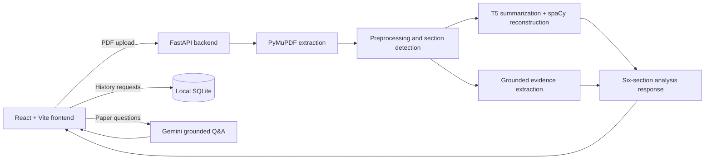

# ReLens

ReLens is a paper-grounded research assistant created by **Team WiS (Women In STEM)**:
Garima Johar, Ifza Akhtar, Priya Bora, and Riddhima, students of B.Tech CSE (AI & ML).
It turns dense research PDFs into readable, page-aware summaries and structured insights.

## Architecture



## Technology stack

- **Frontend:** React, Vite, modular CSS
- **Backend:** Python, FastAPI, Pydantic
- **NLP:** PyMuPDF, Hugging Face T5, spaCy, YAKE, NLTK
- **Storage:** Local SQLite through the FastAPI history API
- **Metadata and Q&A:** Crossref enrichment and paper-grounded Gemini Q&A

## Analysis format

Every paper is organized into:

1. Research Overview
2. Background & Problem Statement
3. Methodology
4. Dataset & Experimental Setup
5. Results & Discussion
6. Limitations & Conclusion

## Application snapshots

Place screenshots in `docs/screenshots/` and keep these names:

| View | Snapshot |
|---|---|
| Upload and processing | `docs/screenshots/upload.png` |
| Research overview | `docs/screenshots/overview.png` |
| Research insights | `docs/screenshots/insights.png` |
| Detailed analysis | `docs/screenshots/detailed-analysis.png` |

## Development

```powershell
uv run pytest -q
Set-Location frontend
npm run build
```
