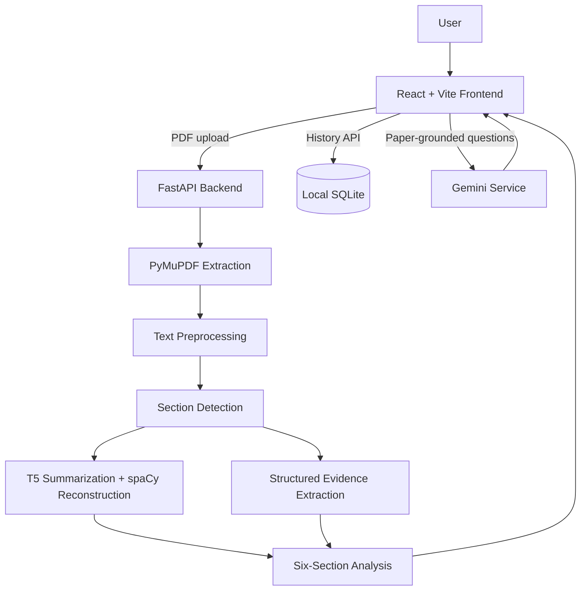

# ReLens — AI-Powered Research Paper Analyzer

**Making academic research papers easier to understand.**

Research papers contain valuable information, but technical terminology, mathematical formulations, experimental results, and lengthy explanations can make them difficult to understand quickly.

That is what we built **ReLens** for.

ReLens is an NLP-powered research paper analyzer that turns an uploaded academic PDF into a structured, readable explanation. It organizes the paper into meaningful sections so readers can understand the research objective, methodology, experiments, results, and limitations without losing the technical context.

It also includes interactive question answering for paper-grounded exploration.

---

## What can ReLens do?

- **PDF Analysis:** Extract text while preserving page-level information.
- **Structured Summarization:** Generate a six-section research analysis.
- **Research Insights:** Show objectives, methodology, datasets, findings, and limitations.
- **Keyword Extraction:** Identify important terms and concepts.
- **Interactive Q&A:** Ask questions about an uploaded paper.
- **Analysis History:** Access previously generated analyses through local SQLite storage.

## How the analysis is structured

| Section | What it explains |
|---|---|
| **01. Research Overview** | Central idea, motivation, objectives, and contribution. |
| **02. Background & Problem Statement** | Problem being addressed and research gap. |
| **03. Methodology** | Proposed approach, architecture, algorithms, and equations. |
| **04. Dataset & Experimental Setup** | Datasets, configurations, preprocessing, and experiments. |
| **05. Results & Discussion** | Metrics, numerical results, comparisons, and observations. |
| **06. Limitations & Conclusion** | Limitations, conclusions, and future directions. |

---

## Application Preview

Add screenshots captured from the running application to `assets/screenshots/`.

### 1. Home & Paper Upload

Starting point for uploading a research paper and initiating analysis.


### 2. Research Paper Analysis

The main interface presents the paper through the six-section summary structure.


### 3. Research Insights

Focused view of objectives, methodology, datasets, findings, and limitations.


### 4. Interactive Paper Q&A

Paper-grounded questions and answers through ReLens AI-assistant


### 5. Analysis History and About WiS page 

Previously analyzed papers stored through the FastAPI SQLite history service.


---

## Architecture

ReLens uses a React frontend and a Python FastAPI backend. The backend coordinates PDF extraction, preprocessing, section identification, summarization, evidence extraction, metadata enrichment, and paper-grounded Q&A.

### High-level architecture



---

## NLP Pipeline


### Pipeline stages

1. **PDF extraction:** PyMuPDF extracts text, metadata, and page references.
2. **Text preprocessing:** Whitespace, line breaks, repeated margins, and layout noise are cleaned.
3. **Section extraction:** Research sections are identified and preserved.
4. **Keyword extraction:** YAKE surfaces important paper concepts.
5. **Chunking and summarization:** Long sections are split into tokenizer-aware chunks and summarized hierarchically.
6. **Summary reconstruction:** Generated content is formatted into readable, conservative paragraphs.
7. **Structured analysis:** Evidence is organized into the canonical six-section response.

---

## Technology Stack

| Technology | Role |
|---|---|
| Python | Backend and NLP processing |
| FastAPI | Backend API |
| PyMuPDF | PDF text extraction |
| Hugging Face Transformers / T5 | Transformer-based summarization |
| spaCy | Linguistic processing |
| YAKE | Keyword extraction |
| NLTK | Sentence tokenization fallback |
| Gemini | Interactive paper-grounded Q&A |
| React | Frontend |
| Vite | Frontend development and build tooling |
| SQLite | Local analysis history |
| Crossref | Optional publication metadata enrichment |

---

## Project Structure

```text
ReLens/
├── app.py
├── pyproject.toml
├── uv.lock
├── README.md
├── .gitignore
├── components/
│   ├── __init__.py
│   ├── paper_overview.py
│   ├── report_ui.py
│   └── upload.py
├── backend/
│   ├── api/
│   │   ├── __init__.py
│   │   └── main.py
│   ├── src/
│   │   ├── __init__.py
│   │   ├── analyzer.py
│   │   ├── gemini_service.py
│   │   ├── history_store.py
│   │   ├── information_extractor.py
│   │   ├── keyword_extractor.py
│   │   ├── metadata_extractor.py
│   │   ├── pdf_processor.py
│   │   ├── section_extractor.py
│   │   ├── summarizer.py
│   │   ├── summarizer_distilbart_backup.py
│   │   ├── summary_reconstructor.py
│   │   └── text_preprocessor.py
│   ├── config.py
│   ├── requirements.txt
│   └── uv.lock
├── data/
│   ├── BERT.pdf
│   ├── attention.pdf
│   ├── transfer_learning.pdf
│   └── unet.pdf
├── models/
│   └── .gitkeep
├── frontend/
│   ├── public/
│   │   ├── favicon.svg
│   │   ├── icons.svg
│   │   └── relens-logo.png
│   └── src/
│       ├── assets/
│       │   ├── hero.png
│       │   ├── logo.png
│       │   ├── react.svg
│       │   └── vite.svg
│       ├── components/
│       │   ├── AboutView.jsx / AboutView.css
│       │   ├── AnalysisProgressModal.jsx / AnalysisProgressModal.css
│       │   ├── ChatPanel.jsx / ChatPanel.css
│       │   ├── DetailedAnalysis.jsx / DetailedAnalysis.css
│       │   ├── ExportModal.jsx / ExportModal.css
│       │   ├── HomeSidebar.jsx / HomeSidebar.css
│       │   ├── InsightCard.jsx / InsightCard.css
│       │   ├── KeywordList.jsx / KeywordList.css
│       │   ├── Navbar.jsx / Navbar.css
│       │   ├── Sidebar.jsx / Sidebar.css
│       │   ├── SummaryCard.jsx / SummaryCard.css
│       │   └── UploadZone.jsx / UploadZone.css
│       ├── data/
│       │   └── mockData.js
│       ├── pages/
│       │   ├── Dashboard.jsx / Dashboard.css
│       │   └── Home.jsx / Home.css
│       ├── utils/
│       │   └── paperAdapter.js
│       ├── App.jsx
│       ├── App.css
│       ├── flatDesign.css
│       ├── index.css
│       ├── main.jsx
│       ├── index.html
│       ├── package.json
│       ├── package-lock.json
│       ├── vite.config.js
│       ├── eslint.config.js
│       ├── README.md
│       └── .gitignore
└── tests/
   ├── BASELINE_COMPARISON.md
   ├── __init__.py
   ├── ask_api.py
   ├── conftest.py
   ├── content_filter.py
   ├── full_paper.py
   ├── gemini.py
   ├── info.py
   ├── keywords.py
   ├── test_api_contract.py
   ├── test_core_pipeline.py
   ├── test_metadata_history.py
   ├── test_pdf_and_chunking.py
   ├── test_structured_analysis.py
   └── test_summarise.py
```

---

## Running Locally

### Prerequisites

- Python
- Node.js and npm
- uv
- Git

### Backend

```powershell
Set-Location backend
uv sync
uv run uvicorn api.main:app --reload
```

### Frontend

Open another terminal:

```powershell
Set-Location frontend
npm install
npm run dev
```

Configure the required Gemini environment variable using the project's environment configuration.

### Tests

```powershell
uv run pytest -q
Set-Location frontend
npm run build
```

---

## Contributors

Developed by **Team WiS (Women In STEM)**:

- Garima Johar
- Ifza Akhtar
- Priya Bora
- Riddhima

**Program:** B.Tech CSE (AI & ML)
**Domain:** Natural Language Processing, Document Intelligence, and Applied AI

## Future Improvements

- More reliable mathematical equation and table extraction.
- Better section detection across varied paper formats.
- Stronger source-grounded summary reconstruction.
- Broader factuality and coverage evaluation.
- Improved handling of scanned and complex-layout PDFs.
